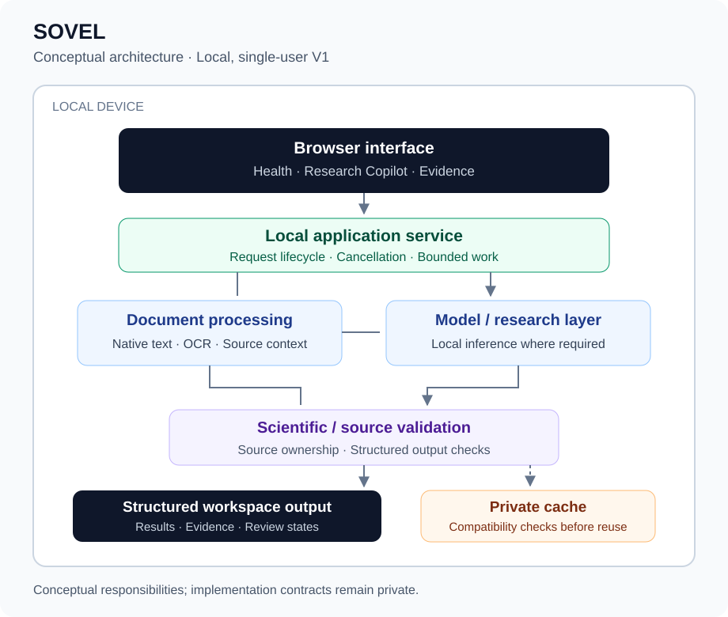

# SOVEL

**Local-first biomedical intelligence for health information, research questions, and scientific evidence.**

**V1 Release Candidate · Accepted October 18, 2026**  
Developed by [Aarushi Singh](https://github.com/aarusheye)

[Architecture](docs/architecture.md) · [Validation](docs/validation.md) · [Demo plan](assets/demo/README.md)

> **Product preview:** UI screenshots and a short walkthrough will be added after public-content review. This repository currently presents documentation and a conceptual architecture diagram.

## What SOVEL is

SOVEL is a biomedical intelligence workspace that brings three tasks into one local application: understanding laboratory information, exploring biomedical questions, and examining evidence from scientific papers. Its engineering emphasis is traceability: retain the source, distinguish observations from interpretation, and make uncertainty visible.

The accepted V1 runs locally for a single user with local model inference. It is an educational and research portfolio project; outputs do not establish diagnoses or clinical decisions.

## Why I built it

My background in biotechnology and biomedical research shaped SOVEL's central question: how can AI make complex biomedical information easier to inspect without obscuring the evidence behind it? I built SOVEL to connect scientific reasoning with practical healthcare software engineering, with particular attention to document fidelity, source attribution, and reliable application behavior.

## Three workspaces

### Health

Turn supported laboratory documents into an organized view of reported results, units, reference ranges, and source context. Native PDF text and scanned-document processing support different input conditions. Missing information and uncertain extraction remain visible for review. Compatible dated reports can be compared with identity and measurement-context checks.

### Research Copilot

Explore biomedical concepts, interpret supplied notes, compare ideas, and develop conceptual research questions and plans. Adjustable explanation depth supports plain-language learning through advanced discussion. Responses distinguish knowledge, inference, proposals, assumptions, and uncertainty. V1 does not retrieve literature or execute experiments or analyses.

### Research Evidence Workspace

Analyze a supplied paper or compare multiple papers around a scientific question. Inspect study methods, findings, limitations, and supporting excerpts. Source-owned synthesis keeps each paper's observations attached to that paper during comparison; citation and scientific checks address tested attribution and claim-consistency failures.

## Engineering highlights

- **Document fidelity:** structured biomedical ingestion with native PDF and OCR paths, source context, and explicit review states.
- **Local execution:** a browser interface, local application service, and local model inference.
- **Controlled background work:** bounded document workers, cancellation, cleanup, and explicit error handling.
- **Evidence integrity:** source ownership, citation checks, and scientific claim validation before successful output is accepted.
- **Cache integrity:** private caches with compatibility checks and revalidation; failed processing is not treated as reusable success.
- **Request ownership:** cancellation and session changes prevent obsolete responses from restoring prior document state.
- **Verification across layers:** backend and frontend tests, evaluations, browser transport tests, and actual File-to-render browser checks.

## V1 validation

The accepted release record reports the following results. These are separate suites and overlapping checks, not an additive total.

| Verification | Accepted result |
| --- | --- |
| Backend | 578 run: **575 passed**, 3 opt-in skips |
| Focused Evidence tests | **136 passed** |
| Fast evaluations | **75/75 passed** |
| Frontend | **352 passed**, 6 opt-in skips |
| Browser transport | **17 passed** |
| TypeScript / production build | **Passed** |
| Final Evidence File/browser cases | **3/3 passed** |
| Evidence theme/viewport checks | **24 passed** |
| Final isolated live Evidence cases | **4/4 HTTP 200; all correctness checks passed** |

Two of the four final isolated live Evidence cases exceeded their unchanged latency targets. The raw all-criteria result remains **2/4**. Skipped opt-in tests are reported separately from passes and failures.

[Read the validation scope, acceptance criteria, and performance results →](docs/validation.md)

## Architecture

The browser presents the three workspaces. Local processing prepares supported documents, the appropriate workflow performs deterministic processing or local model interaction, and source/scientific checks govern structured output. Private cache reuse sits behind compatibility and validity checks. This is a conceptual overview; implementation contracts remain private.

[Explore the architecture and engineering tradeoffs →](docs/architecture.md)

## Technology

Verified against the accepted release's dependency configuration and application imports:

| Layer | Technologies |
| --- | --- |
| Interface | React, TypeScript, Vite |
| Structured client validation | Zod |
| Local application service | Python, FastAPI, Pydantic, HTTPX, Uvicorn |
| Local model runtime | Ollama |
| Document handling | PDF.js via unpdf; native PDF and OCR processing |
| Automated verification | Python unittest, Vitest, Testing Library, Node.js test runner |

## Privacy and local-first design

V1 is designed for local, single-user operation with loopback-only application access and local inference. Document processing and private caches remain under local control, with bounded background work and attention to avoiding unnecessary exposure of sensitive content.

Local operation still requires responsible handling of source files and cached excerpts. V1 is not a remotely authenticated, multi-user deployment. No HIPAA certification, regulatory authorization, clinical validation, or universal scientific-correctness guarantee is claimed.

## Current limitations and post-V1 roadmap

Some uncached multi-document Evidence workflows exceed the desired latency target. The two remaining misses in the final isolated Evidence evaluation are performance-only; the release record identifies no remaining known P0/P1 correctness, safety, privacy, or functional blockers within the accepted scope.

Post-V1 priorities are latency optimization, broader document/workflow support, deployment improvements, and additional evidence and research capabilities. Dependency maintenance and build-warning cleanup are also recorded follow-up work. The accepted release remains a local research application.

## Screenshots and demo

**Screenshot placeholder:** reviewed interface captures are pending. See the [exact capture list](assets/screenshots/README.md).  
**Demo placeholder:** a 60–90 second recorded walkthrough is pending. See the [storyboard](assets/demo/README.md).

## Source Availability

SOVEL is a privately developed portfolio project. Production source code and implementation details are not publicly distributed. This repository contains project documentation, demonstrations, and selected technical materials only.

© 2026 Aarushi Singh. All rights reserved.
