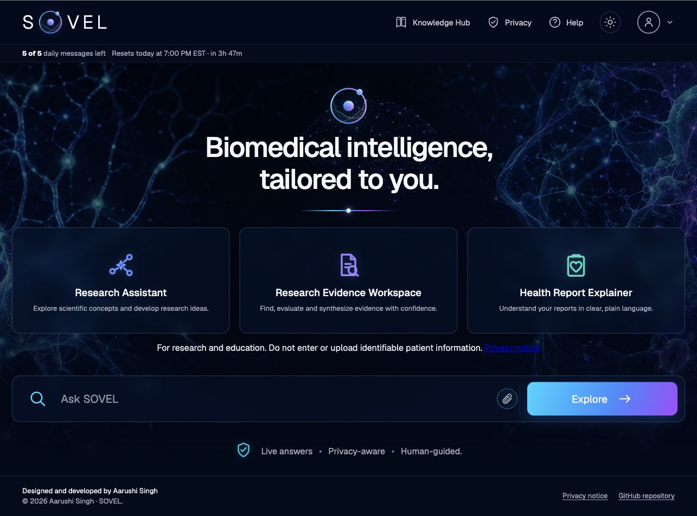
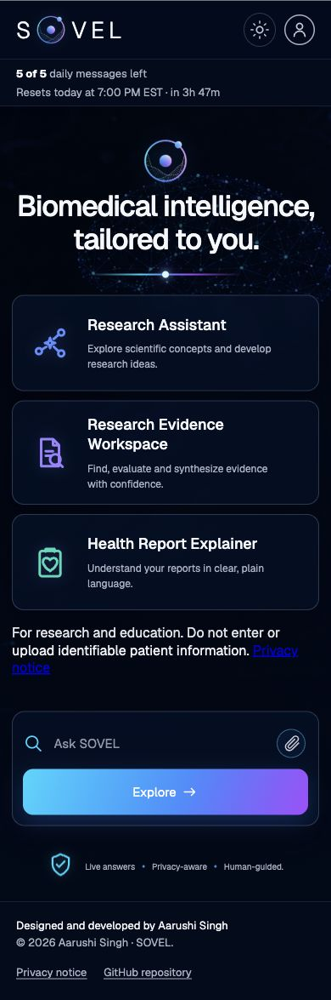

# SOVEL in the browser

[Open SOVEL](https://sovel.punimon.com) · [Try the workspace walkthrough](../demo/README.md)

These screenshots show the public home screen after guest verification on November 27, 2026. Both were captured from the same session before submitting a question or attaching a document. The displayed allowance and local reset time belong to that session.

## Desktop

The three workspace cards sit above the shared question and attachment controls.

## Mobile layout

At a 390-pixel browser width the workspace choices stack vertically. The message allowance, attachment control and privacy notice remain visible.

