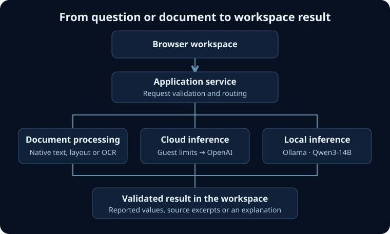

# How SOVEL works

[Project overview](../README.md) · [Validation record](validation.md)

## From a browser action to an answer

The public application serves the React frontend and Python API from one HTTPS origin on Render. The browser handles workspace selection, attachments and presentation. The backend validates incoming requests and owns model calls. In the cloud it calls the OpenAI API directly. In the local configuration it can call Ollama with Qwen3-14B.

| Layer | Technology | Responsibility |
| --- | --- | --- |
| Interface | React, TypeScript, Vite, Zod | Build the browser UI, keep the submitted question and files associated with the result, and validate response shapes before display. |
| Application | Python, FastAPI, Pydantic, HTTPX | Validate inputs, coordinate document and generation steps, and communicate with the inference provider. |
| Documents | unpdf, native PDF geometry processing, Tesseract OCR | Read text and layout where available and use OCR for supported scanned content. |
| Hosting and durable state | Docker, Render, SQLite on persistent storage | Deliver the application and retain usage accounting across restarts. |
| Inference | Direct OpenAI API in the cloud, Ollama locally | Generate structured text for tasks that require a model. |

## Why the workspaces take different paths

**Research Assistant.** A question, selected depth and any supported document context shape the request. The service checks the structured answer and applies scientific-content rules before the interface displays it. A bounded repair can address an invalid response. A well-formed response can still be irrelevant or scientifically wrong.

**Research Evidence Workspace.** Text is associated with its originating paper and page. The pipeline builds paper-level records before synthesizing across sources. Claims and excerpts are checked for attribution so that a reader can revisit the passage. A comparison is limited by the supplied papers, the text that could be extracted and the excerpts selected for analysis.

**Health Report Explainer.** A native PDF may carry usable text and table positions. A scan may need OCR. SOVEL uses deterministic parsing to associate reported measurements with units, ranges and source context. Extraction uncertainty matters because a shifted column can change the meaning of a number. Comparison across dates depends on compatible reports and measurement context.

For multi-file Evidence and Health submissions, the reviewed release requires the whole attached batch to be ready and compatible. An unreadable document can be removed before continuing. Manual workspace selection preserves the classified document type.

## Access, privacy and operating limits

Guest verification establishes a browser session. Daily messages are shared across eligible AI features. The service checks session limits and reserves from a durable shared budget before dispatching a guest model call. Concurrent calls and internal repairs need financial headroom. A repair belongs to the same user action. Bounded uploads, processing deadlines and rate limits constrain resource use.

The optional analytics system stores aggregate activity separately from the spending ledger. Its design excludes raw prompts, answers, documents and raw IP addresses from analytics. Broad research categories are classified locally, with low-frequency categories suppressed. Daily and weekly detail expires after 90 days while analytics runs. Selected all-time totals remain. Session counts can include repeat visitors.

Cloud AI workflows may send relevant question or document text to the model provider. The local inference configuration offers a different processing path. Use synthetic reports when exploring the workspace and follow the public application's [privacy notice](https://sovel.punimon.com/privacy).
